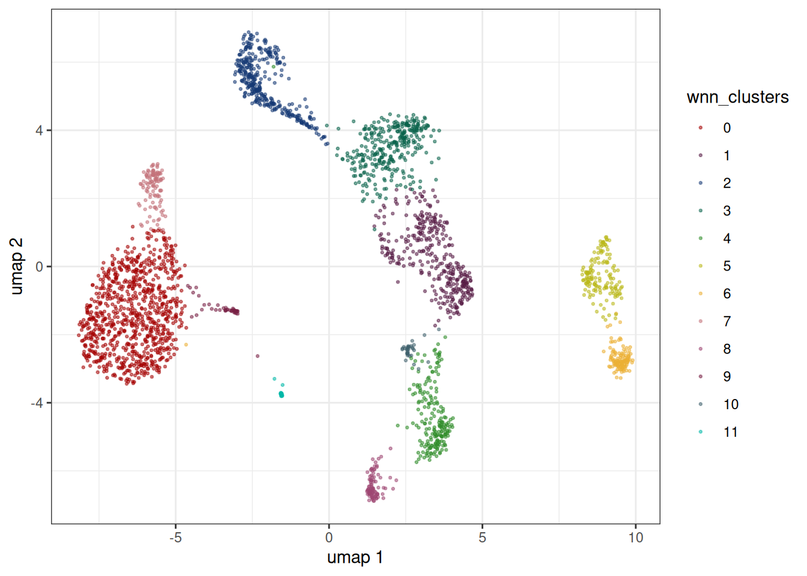

# Joint RNA and ATAC analysis with bixverse

## Intro

10x multiome measures gene expression and chromatin accessibility in the
same nuclei. This vignette takes the unsorted 3k PBMC data set (Cell
Ranger ARC 2.0.0) from the raw files to linked peaks and genes: fragment
QC and multiplet calls, peaks called per cluster, TF-IDF and LSI, the
weighted nearest neighbour graph over both modalities, gene activity and
label transfer, differential accessibility and peak to gene links.

ATAC lives next to the RNA in a `SingleCellsMultiModal`: a second store
under `atac/` with peaks as features, log-CPM as the norm until
[`run_tfidf_sc()`](https://gregorlueg.github.io/bixverse/reference/run_tfidf_sc.md)
switches it to TF-IDF. Its cells are the RNA cells, in the same order,
so the RNA cell filter applies to both. Read the [multi-modal
vignette](https://gregorlueg.github.io/bixverse/articles/multi_modal_single_cells.html)
first if you have not. ATAC without RNA has [its own
vignette](https://gregorlueg.github.io/bixverse/articles/atac_only.html).

The numerics are ports, checked against the originals on test data:
Signac for the counting, QC, TF-IDF, LSI and gene activity, MACS3 for
the peak calling, AMULET for the multiplets and Seurat for the label
transfer. Motif analysis (chromVAR) and coverage tracks are not in
bixverse yet.

``` r

library(bixverse)
library(bixverse.plots)
library(patchwork)
library(ggplot2)
library(data.table)
#> 
#> Attaching package: 'data.table'
#> The following object is masked from 'package:base':
#> 
#>     %notin%
```

## The data

[`download_pbmc_multiome()`](https://gregorlueg.github.io/bixverse/reference/download_pbmc_multiome.md)
fetches the filtered feature barcode matrix (RNA and Cell Ranger’s peak
counts in one h5), the fragment file with its tabix index, Cell Ranger’s
peaks, the GENCODE v32 annotation Cell Ranger ARC’s GRCh38 reference was
built from, and the ENCODE hg38 blacklist.

``` r

data_dir <- download_pbmc_multiome()
h5_path <- file.path(data_dir, "pbmc_unsorted_3k_filtered_feature_bc_matrix.h5")
fragments <- file.path(data_dir, "pbmc_unsorted_3k_atac_fragments.tsv.gz")
gtf <- file.path(data_dir, "gencode.v32.primary_assembly.annotation.gtf.gz")
blacklist <- file.path(data_dir, "hg38-blacklist.v2.bed.gz")

exp_dir <- file.path(tempdir(), "pbmc_multiome")
dir.create(exp_dir, showWarnings = FALSE)
```

## Loading

The RNA comes from the `Gene Expression` rows of the h5, the ATAC from
its `Peaks` rows.
[`add_atac_tenx_sc()`](https://gregorlueg.github.io/bixverse/reference/add_atac_tenx_sc.md)
writes the peak store for every cell of the RNA store, in its order; it
counts Tn5 insertions, as Cell Ranger does.

``` r

sc_object <- SingleCellsMultiModal(dir_data = exp_dir)
sc_object <- load_tenx_h5(sc_object, h5_path = h5_path, .verbose = FALSE)
sc_object <- add_atac_tenx_sc(sc_object, h5_path = h5_path, .verbose = FALSE)

sc_object
#> Single cell experiment (Multi-modal).
#>   No cells (original): 2956
#>    To keep n: 2956
#>   RNA:
#>     No genes: 16556
#>     HVG calculated: FALSE
#>     PCA calculated: FALSE
#>     Other embeddings: none
#>     KNN generated: FALSE
#>     Graph generated: FALSE
#>   ADT:
#>     Present: FALSE
#>     No features: 0
#>     PCA calculated: FALSE
#>     Other embeddings: none
#>     KNN generated: FALSE
#>     Graph generated: FALSE
#>   ATAC:
#>     Present: TRUE
#>     Kind: peak (insertion counts)
#>     TF-IDF: FALSE
#>     Other embeddings: none
#>     KNN generated: FALSE
#>     Graph generated: FALSE
#>   Stale artefacts: none
```

``` r

head(get_sc_var(sc_object, modality = "atac"))
#>    feature_idx         feature_id  chrom  start    end
#>          <int>             <char> <char>  <int>  <int>
#> 1:           1    chr1:9782-10672   chr1   9782  10672
#> 2:           2 chr1:180547-181446   chr1 180547 181446
#> 3:           3 chr1:191121-191998   chr1 191121 191998
#> 4:           4 chr1:267553-268447   chr1 267553 268447
#> 5:           5 chr1:270906-271782   chr1 270906 271782
#> 6:           6 chr1:273943-274789   chr1 273943 274789
```

## Quality control

Per cell from the fragment file: fragments, nucleosome signal (mono-
over nucleosome-free fragments), TSS enrichment, the fraction on chrM
and the fraction of insertions in peaks. Cell Ranger ARC leaves chrM out
of the fragment file, so the ATAC mito fraction is zero throughout here;
the RNA side has its own.

``` r

sc_object <- fragment_qc_sc(sc_object, fragments = fragments, gtf = gtf)

var <- get_sc_var(sc_object)
mito <- var[grepl("^MT-", gene_name), gene_id]
sc_object <- gene_set_proportions_sc(
  sc_object,
  gene_set_list = list(MT = mito),
  .verbose = FALSE
)
```

The two library-level checks first: insertions pile up at TSSs, and
fragment lengths come in nucleosome steps. A flat TSS profile or a
smooth length distribution means a failed library, whatever the per-cell
numbers say.

``` r

profiles <- fragment_profiles_sc(sc_object, fragments = fragments, gtf = gtf)

tss_profile_plot_sc(profiles$tss) + fragment_length_plot_sc(profiles$lengths)
```

``` r

obs <- sc_object[[c(
  "cell_id",
  "lib_size",
  "nnz",
  "MT",
  "atac_n_fragments",
  "atac_lib_size",
  "atac_nucleosome_signal",
  "atac_tss_enrichment",
  "atac_frip"
)]]

ggplot(obs, aes(x = atac_n_fragments, y = atac_tss_enrichment)) +
  geom_point(size = 0.5, alpha = 0.5) +
  scale_x_log10() +
  labs(x = "Fragments per cell", y = "TSS enrichment") +
  theme_bx()
```


### Multiplets

Nuclei carry two copies of each chromosome, so a locus covered by more
than two of a cell’s fragments points at a second nucleus. AMULET counts
those loci per cell and tests them against a Poisson background, without
clustering or RNA. Regions that pile up fragments in every cell, the
blacklist, are left out; a repeat list would clean the calls further.

``` r

sc_object <- amulet_sc(sc_object, fragments = fragments, restrict_beds = blacklist)

multiplet <- sc_object[["amulet_multiplet"]][[1]]
sprintf("%i of %i cells called multiplets", sum(multiplet), length(multiplet))
#> [1] "113 of 2956 cells called multiplets"
```

### Thresholds

On the ATAC side we keep cells with 1,000 to 100,000 insertions in
peaks, a nucleosome signal under 2 and a TSS enrichment over 2, cut-offs
that sit in the tails of the distributions above. On the RNA side we
flag MAD outliers on library size and genes, and cells above 3 MADs of
mitochondrial share.

``` r

atac_qc <- run_cell_qc_fixed(
  metrics = list(
    atac_lib_size = obs$atac_lib_size,
    atac_nucleosome_signal = obs$atac_nucleosome_signal,
    atac_tss_enrichment = obs$atac_tss_enrichment
  ),
  cells_to_keep = get_cells_to_keep(sc_object),
  hard_thresholds = list(
    atac_lib_size = c(lower = 1000, upper = 100000),
    atac_nucleosome_signal = c(upper = 2),
    atac_tss_enrichment = c(lower = 2)
  )
)

plots <- violin_plot_sc(atac_qc)
plots$atac_lib_size + plots$atac_nucleosome_signal + plots$atac_tss_enrichment
```


``` r

rna_qc <- run_cell_qc(
  metrics = list(
    log10_lib_size = log10(obs$lib_size),
    log10_nnz = log10(obs$nnz),
    MT = obs$MT
  ),
  cells_to_keep = get_cells_to_keep(sc_object),
  directions = c(
    log10_lib_size = "twosided",
    log10_nnz = "twosided",
    MT = "above"
  ),
  threshold = 3
)

plots <- violin_plot_sc(rna_qc)
plots$log10_lib_size + plots$log10_nnz + plots$MT
```


``` r

drop <- atac_qc$combined | rna_qc$combined | multiplet
sprintf(
  "ATAC fails %i, RNA fails %i, multiplets %i, dropped %i of %i",
  sum(atac_qc$combined),
  sum(rna_qc$combined),
  sum(multiplet),
  sum(drop),
  length(drop)
)
#> [1] "ATAC fails 121, RNA fails 89, multiplets 113, dropped 295 of 2956"

sc_object <- set_cells_to_keep(sc_object, obs$cell_id[!drop])
```

## RNA

Highly variable genes, PCA, kNN, Leiden. These clusters are what the
peaks get called on below.

``` r

sc_object <- find_hvg_sc(sc_object, hvg_no = 2000L, .verbose = FALSE)
sc_object <- calculate_pca_sc(sc_object, no_pcs = 50L, .verbose = FALSE)
sc_object <- find_neighbours_sc(
  sc_object,
  no_embd_to_use = 30L,
  .verbose = FALSE
)
sc_object <- find_clusters_sc(sc_object, res = 0.8, .verbose = FALSE)
sc_object <- umap_sc(sc_object, no_embd_to_use = 30L, .verbose = FALSE)

embedding_plot_sc(
  sc_object,
  embedding = "umap",
  colour_by = "leiden_clustering",
  discrete = TRUE,
  point_size = 0.5
)
```


## Peaks

Cell Ranger calls peaks on all cells pooled, which under-calls rare
populations. We call them per RNA cluster with bixverse’s port of MACS3
`callpeak` (`--nomodel --extsize 200 --shift -100` on the Tn5
insertions), merge the clusters’ peaks, drop those on blacklist regions
and on contigs, and recount the fragments against the merged set. The
new store replaces the Cell Ranger one.

``` r

cr_peaks <- nrow(get_sc_var(sc_object, modality = "atac"))

peaks <- call_peaks_sc(
  sc_object,
  fragments = fragments,
  group_by = "leiden_clustering"
)
peaks <- peaks[grepl("^chr[0-9XY]+$", chrom)]
peaks <- remove_blacklisted(peaks, blacklist)
sprintf(
  "Cell Ranger peaks: %i, merged per-cluster peaks: %i",
  cr_peaks,
  nrow(peaks)
)
#> [1] "Cell Ranger peaks: 81156, merged per-cluster peaks: 123282"

sc_object <- add_atac_fragments_sc(
  sc_object,
  fragments = fragments,
  peaks = peaks,
  overwrite = TRUE,
  .verbose = FALSE
)
sc_object <- annotate_peaks_sc(sc_object, gtf = gtf)

head(get_sc_var(sc_object, modality = "atac"))
#>    feature_idx         feature_id  chrom  start    end closest_gene
#>          <int>             <char> <char>  <int>  <int>       <char>
#> 1:           1 chr1:817010-817534   chr1 817010 817534       SAMD11
#> 2:           2 chr1:821087-821409   chr1 821087 821409       SAMD11
#> 3:           3 chr1:827161-827846   chr1 827161 827846       SAMD11
#> 4:           4 chr1:844286-844951   chr1 844286 844951       SAMD11
#> 5:           5 chr1:858000-858258   chr1 858000 858258       SAMD11
#> 6:           6 chr1:858458-858674   chr1 858458 858674       SAMD11
#>       closest_gene_id distance_to_gene distance_to_tss
#>                <char>            <num>           <num>
#> 1: ENSG00000187634.12           106393         -106655
#> 2: ENSG00000187634.12           102518         -102679
#> 3: ENSG00000187634.12            96081          -96424
#> 4: ENSG00000187634.12            78976          -79309
#> 5: ENSG00000187634.12            65669          -65798
#> 6: ENSG00000187634.12            65253          -65361
```

## TF-IDF and LSI

TF-IDF over the kept cells, then a truncated SVD of the TF-IDF. We keep
peaks above the 25th percentile of total counts: the bottom quarter is
mostly noise at this depth. The first LSI component of ATAC data usually
tracks sequencing depth rather than cell identity;
[`calculate_lsi_sc()`](https://gregorlueg.github.io/bixverse/reference/calculate_lsi_sc.md)
leaves it out of the embedding by default, and the depth plot shows
whether that is right here (hollow points are the components left out).

``` r

sc_object <- run_tfidf_sc(sc_object)
sc_object <- find_top_features_sc(sc_object, min_cutoff = "q25")
var_atac <- get_sc_var(sc_object, modality = "atac")
sprintf(
  "%i of %i peaks kept for the LSI",
  sum(var_atac$top_feature),
  nrow(var_atac)
)
#> [1] "92510 of 123282 peaks kept for the LSI"

sc_object <- calculate_lsi_sc(sc_object, .verbose = FALSE)
```

``` r

lsi_depth_plot_sc(get_lsi_depth_cor(sc_object))
```

``` r

sc_object <- find_neighbours_sc(
  sc_object,
  embd_to_use = "lsi",
  no_embd_to_use = 30L,
  modality = "atac",
  .verbose = FALSE
)
sc_object <- umap_sc(
  sc_object,
  embd_to_use = "lsi",
  modality = "atac",
  .verbose = FALSE
)
```

``` r

embedding_plot_sc(
  sc_object,
  embedding = "umap",
  embd_modality = "atac",
  colour_by = "leiden_clustering",
  discrete = TRUE,
  point_size = 0.5
)
```

The RNA clusters stay together on the ATAC UMAP: the two modalities come
from the same nuclei.

## Weighted nearest neighbours

WNN fuses the RNA PCA and the ATAC LSI per cell, weighting each by how
well it predicts the cell’s neighbourhood.

``` r

sc_object <- generate_wnn_graph_sc(
  sc_object,
  modality_2 = "atac",
  embd_to_use_2 = "lsi",
  no_embd_to_use_1 = 30L,
  no_embd_to_use_2 = 30L,
  .verbose = FALSE
)
sc_object <- find_clusters_sc(
  sc_object,
  modality = "wnn",
  name = "wnn_clusters",
  res = 0.8,
  .verbose = FALSE
)
sc_object <- umap_sc(sc_object, modality = "wnn", .verbose = FALSE)
#> Warning in .manifold_inputs(object = object, use_knn = use_knn, embd_to_use =
#> embd_to_use, : Using the cached kNN graph with 20 neighbours; `k = 15`,
#> `knn_method` and `nn_params` only apply with `use_knn = FALSE`.

embedding_plot_sc(
  sc_object,
  embedding = "umap",
  embd_modality = "wnn",
  colour_by = "wnn_clusters",
  discrete = TRUE,
  point_size = 0.5
)
```



``` r

markers <- c("CD3D", "CD8A", "MS4A1", "CD14", "FCGR3A", "NKG7", "LYZ", "IL7R")
marker_ids <- var[match(markers, gene_name), gene_id]

feature_plot_sc(
  sc_object,
  features = marker_ids,
  feature_labels = setNames(markers, marker_ids),
  embedding = "umap",
  embd_modality = "wnn",
  point_size = 0.5
)
```


## Gene activity and label transfer

Gene activity counts fragments over gene body plus 2 kb upstream into a
gene by cell store of its own, the shared feature space for moving
labels from an RNA reference onto ATAC cells. With paired data we know
the answer: the RNA clusters of the same nuclei. Transfer them through
gene activity and the ATAC LSI and count how many come back.

``` r

ga <- gene_activity_sc(
  sc_object,
  fragments = fragments,
  gtf = gtf,
  .verbose = FALSE
)

transfer <- transfer_labels_seurat_sc(
  reference = sc_object,
  query = ga,
  label_column = "leiden_clustering",
  weight_embedding = get_embedding(sc_object, "lsi", modality = "atac"),
  .verbose = FALSE
)

truth <- sc_object[["leiden_clustering", filtered = TRUE]][[1]]
sprintf(
  "transferred label equals the RNA cluster for %.1f%% of cells",
  100 * mean(transfer$predicted_leiden_clustering == as.character(truth))
)
#> [1] "transferred label equals the RNA cluster for 82.5% of cells"
```

Gene activity is a separate `SingleCells`, so the RNA tools run on it.
Methods built on an mRNA count model (residuals, doublet scores) refuse
it, and those that gene length biases (AUCell, ScType, NMF) warn.

The same markers as above, as gene activity instead of expression:

``` r

feature_plot_sc(
  sc_object,
  features = marker_ids,
  feature_labels = setNames(markers, marker_ids),
  embedding = "umap",
  embd_modality = "wnn",
  expr_sc = ga,
  point_size = 0.5
)
```

## Differential accessibility

The marker functions take `modality = "atac"` and test peaks instead of
genes, here every WNN cluster against the rest. On ATAC the default test
is a logistic regression per peak with the library size as covariate
(`group ~ peak + depth` against `group ~ depth`), so a cluster with
deeper cells does not light up every peak. `method = "wilcox"` runs the
Wilcoxon on the TF-IDF instead.

Don’t read these p-values as inference. Every cell counts as a
replicate, so with a few hundred cells per cluster they go
astronomically small with either test; use them to rank peaks. The
closest gene from
[`annotate_peaks_sc()`](https://gregorlueg.github.io/bixverse/reference/annotate_peaks_sc.md)
names them.

``` r

da <- find_all_markers_sc(
  sc_object,
  column_of_interest = "wnn_clusters",
  modality = "atac",
  .verbose = FALSE
)
annotation <- get_sc_var(
  sc_object,
  modality = "atac",
  cols = c("feature_id", "closest_gene", "distance_to_tss")
)
da <- merge(da, annotation, by = "feature_id", all.x = TRUE)

da[fdr < 0.05, .N, by = grp][order(grp)]
#>       grp     N
#>     <int> <int>
#>  1:     0 10798
#>  2:     1  8904
#>  3:     2  9506
#>  4:     3  9197
#>  5:     4  6720
#>  6:     5  9221
#>  7:     6  7572
#>  8:     7 11127
#>  9:     8  5185
#> 10:     9  6425
#> 11:    10  1340
#> 12:    11  6725
```

``` r

head(da[fdr < 0.05][order(-lfc)], 10)
#>                   feature_id   grp      lfc     prop1        prop2 z_scores
#>                       <char> <int>    <num>     <num>        <num>    <num>
#>  1:  chr17:73561095-73561482    11 1.908164 0.3928571 0.0018989745 9.338511
#>  2:   chr7:98642114-98642362    11 1.781399 0.3571429 0.0003797949 9.224580
#>  3:   chr3:49711584-49711870    11 1.763607 0.3928571 0.0037979491 8.585456
#>  4:  chr10:33715301-33715777    11 1.734024 0.3571429 0.0007595898 9.253073
#>  5:   chr7:98641583-98642000    11 1.728459 0.3928571 0.0026585644 8.656052
#>  6:  chr20:43711245-43711660    11 1.666939 0.3214286 0.0022787694 8.326826
#>  7:    chr12:6188947-6189355    11 1.591882 0.3571429 0.0064565134 8.072657
#>  8:  chr10:47441900-47442248    11 1.579680 0.2857143 0.0000000000 8.632262
#>  9: chr8:134683214-134683621    11 1.573452 0.3571429 0.0041777440 7.832864
#> 10:  chr14:89773085-89773520    11 1.544000 0.3214286 0.0026585644 8.001845
#>         p_values          fdr closest_gene distance_to_tss
#>            <num>        <num>       <char>           <num>
#>  1: 4.884906e-21 1.732297e-16         SDK2           83156
#>  2: 1.423377e-20 1.732297e-16        NPTX2           24954
#>  3: 4.523840e-18 2.359570e-14       RNF123           22190
#>  4: 1.090649e-20 1.732297e-16         NRP1         -379278
#>  5: 2.441928e-18 1.783144e-14        NPTX2           24507
#>  6: 4.151942e-17 1.684351e-13        MYBL2           44434
#>  7: 3.439242e-16 9.389304e-13          CD9          -10563
#>  8: 3.007519e-18 1.830125e-14        ANXA8           42083
#>  9: 2.384393e-15 4.388435e-12         ZFAT           29631
#> 10: 6.128433e-16 1.398470e-12      EFCAB11          181474
```

A top peak’s accessibility on the WNN UMAP:

``` r

top_peak <- da[fdr < 0.05][order(-lfc)]$feature_id[1]

feature_plot_sc(
  sc_object,
  features = top_peak,
  embedding = "umap",
  expr_modality = "atac",
  embd_modality = "wnn",
  point_size = 0.5
)
```

## Peak to gene links

A peak whose accessibility rises and falls with a nearby gene’s
expression across cell states is a candidate regulatory element for that
gene.
[`peak_to_gene_sc()`](https://gregorlueg.github.io/bixverse/reference/peak_to_gene_sc.md)
sums both modalities over groups of cells, here fine WNN clusters,
correlates every peak within 250 kb of a TSS with the gene, and tests
the correlation. Fine clusters rather than the cells themselves: single
cells are too sparse for a correlation to mean anything.

``` r

sc_object <- find_clusters_sc(
  sc_object,
  modality = "wnn",
  name = "wnn_fine",
  res = 5,
  .verbose = FALSE
)
links <- peak_to_gene_sc(
  sc_object,
  gtf = gtf,
  group_by = "wnn_fine",
  min_cells = 10L,
  .verbose = FALSE
)

sprintf(
  "%i links at FDR < 0.05 over %i genes",
  nrow(links),
  uniqueN(links$gene_id)
)
#> [1] "55791 links at FDR < 0.05 over 8522 genes"
head(links[order(-r)], 10)
#>                       peak_id         gene_id gene_name distance         r
#>                        <char>          <char>    <char>    <num>     <num>
#>  1:    chr6:39440627-39440827 ENSG00000124780    KCNK17   126267 1.0000000
#>  2:   chr21:26346784-26346984 ENSG00000166265     CYYR1  -226401 0.9996071
#>  3:   chr18:73007257-73007511 ENSG00000166342     NETO1   139239 0.9989419
#>  4: chr11:111364038-111364238 ENSG00000110777   POU2AF1   -91491 0.9985965
#>  5:  chr1:107246977-107247304 ENSG00000162631     NTNG1   107134 0.9984105
#>  6:    chr3:73503785-73504092 ENSG00000121440    PDZRN3  -121002 0.9983326
#>  7:    chr3:31952159-31952545 ENSG00000144645   OSBPL10  -125227 0.9982283
#>  8:     chr20:9388312-9388778 ENSG00000125869     LAMP5  -125812 0.9980020
#>  9:  chr2:164754286-164754486 ENSG00000169507  SLC38A11  -201138 0.9979827
#> 10:     chr20:9457979-9458279 ENSG00000125869     LAMP5   -56228 0.9974990
#>                p          fdr
#>            <num>        <num>
#>  1: 0.000000e+00 0.000000e+00
#>  2: 1.184396e-35 3.252008e-30
#>  3: 6.380516e-31 1.167937e-25
#>  4: 1.424117e-29 1.955106e-24
#>  5: 5.593471e-29 6.143220e-24
#>  6: 9.467892e-29 8.665362e-24
#>  7: 1.844620e-28 1.447083e-23
#>  8: 6.911825e-28 4.687340e-23
#>  9: 7.682176e-28 4.687340e-23
#> 10: 8.155757e-27 4.478669e-22
```

Next on the list: motif enrichment (chromVAR) and coverage tracks. Watch
this space.
