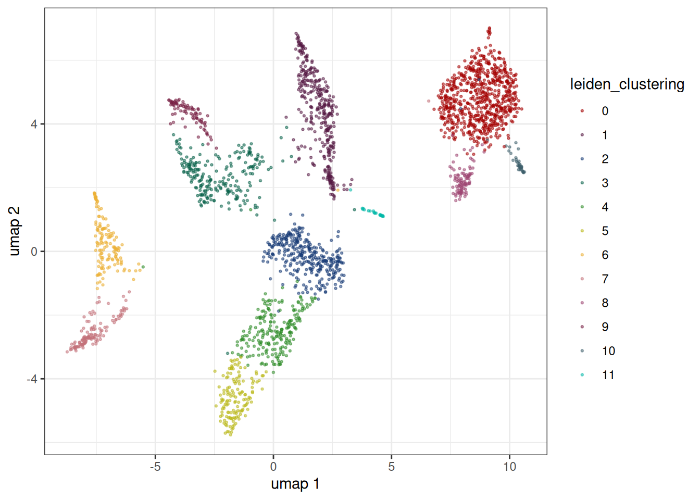

# Single cell ATAC without RNA

## Intro

Most single cell ATAC data has no RNA next to it: Cell Ranger ATAC runs,
or public fragment files. This vignette starts from a fragment file
alone: cells called from the fragment counts, QC and multiplets, peaks
per cluster, TF-IDF and LSI, clusters and differential accessibility,
then gene activity and labels transferred from an RNA reference.

The fragments are the ATAC half of the 10x PBMC 3k multiome used in the
[multiome
vignette](https://gregorlueg.github.io/bixverse/articles/atac_multiome.html).
That has a use here: its RNA half is a reference built from the very
same nuclei, so we can check the transferred labels against the RNA
clusters of each cell, which a real ATAC-only data set cannot offer.

An ATAC-only experiment is a `SingleCellsAtac`: its own store holds the
peaks or tiles, and the ATAC functions take it exactly as they take the
ATAC side of a `SingleCellsMultiModal`. `modality = "atac"` and the
default both name its store.

``` r

library(bixverse)
library(bixverse.plots)
library(patchwork)
library(ggplot2)
library(data.table)
#> 
#> Attaching package: 'data.table'
#> The following object is masked from 'package:base':
#> 
#>     %notin%
```

``` r

data_dir <- download_pbmc_multiome()
fragments <- file.path(data_dir, "pbmc_unsorted_3k_atac_fragments.tsv.gz")
gtf <- file.path(data_dir, "gencode.v32.primary_assembly.annotation.gtf.gz")
blacklist <- file.path(data_dir, "hg38-blacklist.v2.bed.gz")
cr_peaks <- file.path(data_dir, "pbmc_unsorted_3k_atac_peaks.bed")
h5_path <- file.path(data_dir, "pbmc_unsorted_3k_filtered_feature_bc_matrix.h5")

new_dir <- function(name) {
  path <- file.path(tempdir(), name)
  dir.create(path, showWarnings = FALSE)
  path
}
```

## Calling cells

Without a barcode list the cells come from the fragment counts: real
cells carry thousands of fragments, empty droplets a handful. The knee
plot of fragments per barcode, sorted, shows where the two meet. With
Cell Ranger ATAC output, `cellranger = "singlecell.csv"` takes its calls
instead.

``` r

counts <- barcode_fragment_counts(fragments)
counts[, rank := seq_len(.N)]

ggplot(counts, aes(x = rank, y = n_fragments)) +
  geom_line() +
  geom_hline(yintercept = 3000, linetype = "dashed", colour = "grey") +
  scale_x_log10() +
  scale_y_log10() +
  labs(x = "Barcode rank", y = "Fragments") +
  theme_bx()
```


The knee sits near 3,000 fragments. We call cells there and count them
into the peaks Cell Ranger called on all cells pooled, which every Cell
Ranger ATAC run ships. They are good enough to cluster on; better peaks
come from the clusters below.

``` r

first <- load_atac_fragments(
  SingleCellsAtac(dir_data = new_dir("atac_first")),
  fragments = fragments,
  peaks = cr_peaks,
  min_fragments = 3000L,
  .verbose = FALSE
)

first
#> Single cell experiment (ATAC).
#>   No cells (original): 2597
#>    To keep n: 2597
#>   No features: 81156
#>   Kind: peak (insertion counts)
#>   TF-IDF: FALSE
#>   Embeddings: none
#>   KNN generated: FALSE
#>   Graph generated: FALSE
#>   Gene activity: FALSE
#>   Stale artefacts: none
```

## Quality control

The same metrics as with RNA next to it: fragments, nucleosome signal,
TSS enrichment, and AMULET’s multiplet calls, which need nothing but the
fragments.

``` r

first <- fragment_qc_sc(first, fragments = fragments, gtf = gtf)
first <- amulet_sc(first, fragments = fragments, restrict_beds = blacklist)
```

``` r

profiles <- fragment_profiles_sc(first, fragments = fragments, gtf = gtf)

tss_profile_plot_sc(profiles$tss) + fragment_length_plot_sc(profiles$lengths)
```

``` r

obs <- first[[c(
  "cell_id",
  "atac_n_fragments",
  "atac_nucleosome_signal",
  "atac_tss_enrichment",
  "amulet_multiplet"
)]]
keep <- obs$atac_nucleosome_signal < 2 &
  obs$atac_tss_enrichment > 2 &
  !obs$amulet_multiplet
sprintf("keeping %i of %i cells", sum(keep), nrow(obs))
#> [1] "keeping 2460 of 2597 cells"

first <- set_cells_to_keep(first, obs$cell_id[keep])
```

## First clusters

TF-IDF, LSI and Leiden on Cell Ranger’s peaks give the clusters to call
peaks on.

``` r

first <- run_tfidf_sc(first)
first <- find_top_features_sc(first, min_cutoff = "q25")
first <- calculate_lsi_sc(
  first,
  lsi_params = params_atac_lsi(n_comp = 30L),
  .verbose = FALSE
)
first <- find_neighbours_sc(first, embd_to_use = "lsi", .verbose = FALSE)
first <- find_clusters_sc(first, res = 0.8, .verbose = FALSE)
```

## Peaks

Peaks per cluster, merged, blacklist and contigs dropped, then the
fragments counted against them into the experiment we keep, for the
cells that passed QC.

``` r

peaks <- call_peaks_sc(
  first,
  fragments = fragments,
  group_by = "leiden_clustering"
)
peaks <- peaks[grepl("^chr[0-9XY]+$", chrom)]
peaks <- remove_blacklisted(peaks, blacklist)

atac <- load_atac_fragments(
  SingleCellsAtac(dir_data = new_dir("atac_peaks")),
  fragments = fragments,
  peaks = peaks,
  barcodes = get_cell_names(first, filtered = TRUE),
  .verbose = FALSE
)
atac <- fragment_qc_sc(atac, fragments = fragments, gtf = gtf)
atac <- annotate_peaks_sc(atac, gtf = gtf)

atac
#> Single cell experiment (ATAC).
#>   No cells (original): 2460
#>    To keep n: 2460
#>   No features: 117829
#>   Kind: peak (insertion counts)
#>   TF-IDF: FALSE
#>   Embeddings: none
#>   KNN generated: FALSE
#>   Graph generated: FALSE
#>   Gene activity: FALSE
#>   Stale artefacts: none
```

## TF-IDF, LSI, clusters

``` r

atac <- run_tfidf_sc(atac)
atac <- find_top_features_sc(atac, min_cutoff = "q25")
atac <- calculate_lsi_sc(atac, .verbose = FALSE)
```

``` r

lsi_depth_plot_sc(get_lsi_depth_cor(atac))
```

``` r

atac <- find_neighbours_sc(
  atac,
  embd_to_use = "lsi",
  no_embd_to_use = 30L,
  .verbose = FALSE
)
atac <- find_clusters_sc(atac, res = 0.8, .verbose = FALSE)
atac <- umap_sc(atac, embd_to_use = "lsi", .verbose = FALSE)

embedding_plot_sc(
  atac,
  embedding = "umap",
  colour_by = "leiden_clustering",
  discrete = TRUE,
  point_size = 0.5
)
```



## Differential accessibility

On an ATAC experiment the marker functions test peaks by default, with
the logistic regression that takes the library size as covariate. As in
the multiome vignette, treat the p-values as a ranking.

``` r

da <- find_all_markers_sc(
  atac,
  column_of_interest = "leiden_clustering",
  .verbose = FALSE
)
annotation <- get_sc_var(atac, cols = c("gene_id", "closest_gene"))
setnames(annotation, "gene_id", "feature_id")
da <- merge(da, annotation, by = "feature_id", all.x = TRUE)

head(da[fdr < 0.05][order(-lfc)], 10)
#>                   feature_id   grp      lfc     prop1        prop2 z_scores
#>                       <char> <int>    <num>     <num>        <num>    <num>
#>  1:   chr7:98642109-98642369    11 2.572098 0.5238096 0.0004100041 9.989734
#>  2:  chr10:33715301-33715777    11 2.246233 0.4761905 0.0012300123 9.140167
#>  3:   chr7:98641559-98642020    11 2.126829 0.4761905 0.0028700286 8.652970
#>  4:   chr3:53190375-53190965    11 2.042240 0.4761905 0.0065600658 8.244228
#>  5:  chr14:89773085-89773520    11 2.030936 0.4285714 0.0028700286 8.253377
#>  6: chr3:134956410-134956769    11 1.952577 0.3809524 0.0008200082 8.299813
#>  7: chr2:176491200-176491557    11 1.939827 0.4285714 0.0028700286 8.010924
#>  8:  chr20:38725341-38725627    11 1.895438 0.3809524 0.0032800329 7.818633
#>  9: chr9:106757643-106757934    11 1.892387 0.3809524 0.0000000000 8.895523
#> 10:  chr15:58454448-58454750    11 1.890009 0.3333333 0.0008200082 8.126713
#>         p_values          fdr closest_gene
#>            <num>        <num>       <char>
#>  1: 8.451750e-24 3.035953e-19        NPTX2
#>  2: 3.117797e-20 5.599719e-16         NRP1
#>  3: 2.508814e-18 2.252978e-14        NPTX2
#>  4: 8.311467e-17 3.731953e-13        PRKCD
#>  5: 7.698999e-17 3.731953e-13      EFCAB11
#>  6: 5.213770e-17 3.121397e-13        EPHB1
#>  7: 5.692503e-16 1.572926e-12         MTX2
#>  8: 2.670012e-15 5.328305e-12      SLC32A1
#>  9: 2.907231e-19 3.481021e-15       ZNF462
#> 10: 2.205437e-16 6.601791e-13      ALDH1A2
```

## Labels from an RNA reference

Gene activity puts the ATAC cells in gene space, where an RNA reference
can meet them. The reference here is the RNA of the same 3k nuclei,
clustered the usual way; in practice it would be any annotated RNA data
set of the tissue.

``` r

rna <- load_tenx_h5(
  SingleCells(dir_data = new_dir("atac_rna")),
  h5_path = h5_path,
  .verbose = FALSE
)
rna <- find_hvg_sc(rna, hvg_no = 2000L, .verbose = FALSE)
rna <- calculate_pca_sc(rna, no_pcs = 30L, .verbose = FALSE)
rna <- find_neighbours_sc(rna, .verbose = FALSE)
rna <- find_clusters_sc(
  rna,
  res = 0.8,
  name = "rna_cluster",
  .verbose = FALSE
)
```

``` r

ga <- gene_activity_sc(atac, fragments = fragments, gtf = gtf, .verbose = FALSE)

transfer <- transfer_labels_seurat_sc(
  reference = rna,
  query = ga,
  label_column = "rna_cluster",
  weight_embedding = get_embedding(atac, "lsi"),
  .verbose = FALSE
)
```

Each ATAC cell’s predicted cluster against the RNA cluster of the same
barcode:

``` r

truth <- rna[[c("cell_id", "rna_cluster")]]
pred <- merge(
  transfer[, .(cell_id, predicted = predicted_rna_cluster)],
  truth,
  by = "cell_id"
)
sprintf(
  "%i shared cells; the transferred label is right for %.1f%%",
  nrow(pred),
  100 * mean(pred$predicted == as.character(pred$rna_cluster))
)
#> [1] "2399 shared cells; the transferred label is right for 87.5%"
```

``` r

umap_dt <- data.table(
  get_embedding(atac, "umap"),
  predicted = transfer$predicted_rna_cluster
)
setnames(umap_dt, 1:2, c("UMAP_1", "UMAP_2"))

ggplot(umap_dt, aes(UMAP_1, UMAP_2, colour = predicted)) +
  geom_point(size = 0.5, alpha = 0.5) +
  theme_bx()
```


